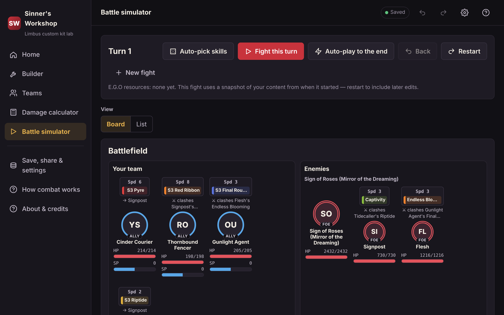

<div align="center">

# Sinner's Workshop

**Build custom Limbus Company kits and test them against the game's real combat rules.**

### [Open the app →](https://pixelenjoyer57-droid.github.io/limbus-calculator/)

[](https://github.com/pixelenjoyer57-droid/limbus-calculator/actions/workflows/pages.yml)
[](LICENSE)
[](LICENSE-DATA.md)
[](https://discord.gg/hZgMnDN5K)



*Free, fan-made and non-commercial. Not affiliated with Project Moon.*

</div>

## What you can do

- **Build** Identities, E.G.O, enemies (including multi-part Abnormalities), encounters, choice events with Skill Checks, E.G.O Gifts, your own statuses and custom coins.
- **Write rules without code**, like "When [On Hit] → only if [target has 5+ Burn] → do [Inflict 2 Burn]". Every rule shows game-style text, and the simulator really runs it.
- **Calculate** one Clash or attack thousands of times, with best and worst cases that show every term of the damage formula.
- **Simulate** whole fights turn by turn on a battle board: pick skills and targets, see Clash odds and every coin flip, auto-play to the end, or run hundreds of fights for win rates.
- **Use the real roster**: about 200 Identities, 110+ E.G.O, 1,150+ enemy variants, 700+ E.G.O Gifts and 1,250+ statuses from the game, ready to pick or to copy and edit.
- **Plan teams** of 12 Sinners and test the Skill Checks of choice events.

## Your work stays yours

- Runs entirely in your browser, on phone or PC, and works offline after the first visit. No account, no ads, no analytics.
- Everything saves automatically, and **Undo / Redo** (Ctrl+Z / Ctrl+Shift+Z) covers deletes too.
- Separate **workshops** (save slots) keep projects apart, and the app remembers where you were, even in the middle of a fight.
- Move your work between devices with a backup file or a share code (**Save, share & settings**).

## How accurate is it?

The combat engine follows the community wiki ([Damage Formula](https://limbuscompany.wiki.gg/wiki/Damage_Formula), [Battles](https://limbuscompany.wiki.gg/wiki/Battles), [Skills](https://limbuscompany.wiki.gg/wiki/Skills), [Sanity](https://limbuscompany.wiki.gg/wiki/Sanity), [Sin Resonance](https://limbuscompany.wiki.gg/wiki/Sin_Resonance) and the status pages), and its tests check it against the wiki's own worked examples. The in-app **How combat works** page explains every rule, and what the simulator simplifies (enemy AI, Low Morale chance, E.G.O Corrosion, slot weight and Aggro).

<details>
<summary>The damage formula in short</summary>

```
Damage = floor( Coin Roll × (1 + Static) × (1 + Dynamic) )   (min 1, min 5% of the roll)
Static  = sin res + damage-type res (or +1/+1.5/+2 when Staggered) + (Off−Def)/(|Off−Def|+25) + crit 0.2 + 0.03 × Clash count
Dynamic = Damage Up/Down, Fragile, Protection, typed variants, passive / skill / gift "+X% damage"
Resistance mod = x−1 (x ≥ 1) · (x−1)/2 (x < 1) · −0.5 (Immune)
Heads chance = 50 + SP · Clash bonus = +1 per 3 levels · SP on Clash win = 10 + 2 × (rounds − 1)
```

</details>

Effects of the in-game content are converted from the wiki text automatically. About half of all effect sentences run as rules; the rest are shown as "Not simulated" notes.

## Accessibility

Dark, light and high-contrast themes, text up to 160%, an extra-readable font (Atkinson Hyperlegible), reduced motion, roomy or compact spacing, large touch targets, full keyboard use and screen-reader labels. Each screen has one main action, sections remember whether they're open, and templates mean you never start from a blank page.

## Feedback and contributing

- **Ideas, questions and custom kits:** the [Discord](https://discord.gg/hZgMnDN5K).
- **Bugs and suggestions:** [open an issue](https://github.com/pixelenjoyer57-droid/limbus-calculator/issues/new/choose).
- **Want to help build it?** Read the [contributing guide](.github/CONTRIBUTING.md) and the [code of conduct](.github/CODE_OF_CONDUCT.md).
- **Found a security problem?** Please report it privately, as described in the [security policy](.github/SECURITY.md).

## Credits and license

- **Game data** is adapted from the [Limbus Company Wiki](https://limbuscompany.wiki.gg), whose original text is licensed [CC BY-SA 4.0](https://creativecommons.org/licenses/by-sa/4.0/). **Changes were made:** pages were converted to compact JSON, values normalised (Uptie 4 / Threadspin IV), effect text partly converted into simulation rules, and some entries merged or omitted. The adapted data in `public/gamedata/` stays under [CC BY-SA 4.0](LICENSE-DATA.md).
- **Code:** [MIT](LICENSE). Third-party software and full attribution: [NOTICE.md](NOTICE.md) and the in-app **About & credits** page.
- **Limbus Company** and its names, text and characters belong to **Project Moon**, and are not covered by either license. No game art, logos, audio or fonts are included.
- This is a free, non-commercial fan project, **not affiliated with, endorsed by or connected to Project Moon**. No ads, donations or paid features.
- **Rights holders:** to have something changed or removed, use the ["Rights holder request" form](https://github.com/pixelenjoyer57-droid/limbus-calculator/issues/new/choose) or message a moderator on the [Discord](https://discord.gg/hZgMnDN5K). Requests are handled promptly.
